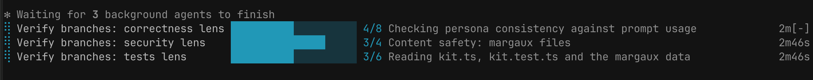

# task-progress

Live progress bars above the Claude Code prompt for background shells and background subagents.



Each running task gets a row: spinner, name, bar with count, current step, elapsed time. A finished row shows `done` or `failed` for 5 seconds, then disappears.

## How progress gets reported

Tasks print lines in this format:

```
::progress::37/120 Migrating users     fraction
::progress::42% Uploading              percentage
::progress::? Indexing repo            no estimate
```

The last line wins, so a task can change its total mid-run.

- **Background shells:** the mod reads new lines from the task's output file (stdout and stderr) every 500 ms.
- **Background subagents:** the mod reads the agent's messages. Until an agent reports progress, its row shows the tool-call count and last action.

## What it changes in Claude Code

- Adds a section of about 140 tokens to the system prompt: long background scripts should print progress lines.
- Appends a similar rule to the task prompt of every background subagent.
- Runs `tail` on background tasks' output files while they run.

## Limitations

- Foreground commands, workflows and Claude's own task list are not tracked.
- Tools that don't print progress lines (e.g. `npm test`) show only name and elapsed time.
- Dev servers and watchers keep a row until stopped.
- Collapse the band with `ctrl+x ctrl+a`.

## Development

```
claude --plugin-dir ./task-progress   # load with hot reload
claude plugin test ./task-progress
claude plugin validate ./task-progress
```
